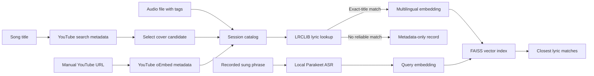

# Semantic Cover Search

A local-first research prototype for discovering song covers on YouTube and experimenting with retrieval from sung phrases. The current implementation **does not identify arbitrary songs by melody or search the entire internet from a recording**.

## Features

- **Discover covers on YouTube:** search YouTube for a song title plus "cover" using `yt-dlp`. Results show video title, channel and watch link. Search metadata is not confirmation that a video is a cover or that the uploader is the performing artist.
- **Local catalog:** add a result from YouTube search, paste a YouTube URL, or upload an audio file. Uploaded MP3 tags can prefill an editable song title and performing artist. YouTube URLs are resolved to public title/uploader metadata via oEmbed.
- **Lyrics lookup, not whole-song transcription:** use LRCLIB's no-key API with a structured song-title lookup and one optional broader fallback query. On temporary HTTP 503, retry once; distinguish rate limiting and network failures from an actual no-match. Use plain lyrics or timestamped-lyrics fallback; display a source-attributed, readable verse view in Gradio. If usable lyrics are found, embed their text locally for FAISS cosine-similarity search. Lyrics may represent a different version of the composition; **not** a verified transcript of the selected video.
- **Metadata-only entries:** if lyrics cannot be matched, or the lyric/embedding service is unavailable, retain the song in the catalog as a reference without inventing a transcript or searchable embedding.
- **Experimental singing search:** record a short phrase in Gradio, transcribe with NVIDIA Parakeet TDT 0.6B v3 on CPU (Faster-Whisper optionally available), and compare that text with the session's available lyric embeddings.
- **Session-only state:** no database and no persistence. Restarting Gradio clears the catalog; this is intentional for a small demo.

## Architecture



**Important:** Neither YouTube metadata nor LRCLIB guarantees that a result is a genuine cover or identifies an unknown song. Parakeet was designed for speech recognition; singing, instrumentals and humming are unreliable. Comparisons against whole lyrics can be weak for very short recorded excerpts. No melodic fingerprinting, chroma/DTW matching, or internet-wide audio identification has been implemented.

## Installation

Use Python 3.11 or 3.12 and a per-project virtual environment.

```powershell
py -3.12 -m venv .venv
.\.venv\Scripts\python.exe -m pip install -r requirements.txt
.\.venv\Scripts\python.exe app.py
```

The app runs at `http://127.0.0.1:7860` by default. The first **singing-search** request can download the Parakeet model (approximately 670 MB) if it is not cached. Catalog entry from metadata/lyrics does **not** download entire YouTube audio files or transcribe full songs.

## Testing

```powershell
.\.venv\Scripts\python.exe -m pytest -q
.\.venv\Scripts\python.exe -m ruff check .
```

Tests mock outside services and do not prove real YouTube or LRCLIB availability, nor melodic/lyric matching accuracy.

## Privacy, provider limitations and rights

- YouTube search uses third-party extraction. Depending on the version, `yt-dlp` may need a JavaScript runtime for complete YouTube support. See the [official setup guide](https://github.com/yt-dlp/yt-dlp/wiki/EJS).
- [LRCLIB](https://lrclib.net/docs) provides a no-key API, with published rate limits and identification requirements. This demo fetches lyrics on demand rather than redistributing a local database. Song lyrics may be copyrighted independently of the API/software license: **check lyric display/indexing rights before public deployment**, even when data comes from an API. Each lyric panel links to the source. Other no-key services such as lyrics.ovh scrape third-party lyric pages and are not enabled as a fallback because their data provenance/reuse terms do not provide a clear basis for a public showcase.
- Uploaded file metadata is processed locally. The singing recording is processed locally by Parakeet/Whisper; known song titles can be sent to LRCLIB; video titles and URLs can be sent to YouTube services.
- The catalog stays in Gradio's server/session memory only. Audio uploaded for lookup is not stored in a project database.
- An old `.local_data/catalog.sqlite3` created by previous development versions is no longer used. `.local_data/` stays in `.gitignore` to prevent accidental commits.

## Potential Enhancements

- Melody-oriented song identification using a licensed reference corpus, robust pitch/chroma representations and sequence alignment.
- Segment-level lyric indexing to improve short-fragment retrieval.
- Test sets of original recordings, covers and unrelated songs, with Recall@K and ranking quality metrics.
- Rights-cleared, user-facing lyric references for a public deployment.
