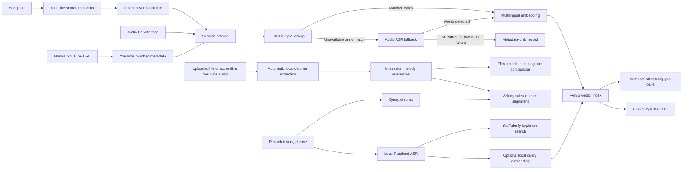

# Semantic Cover Search

A local-first research prototype for discovering song covers on YouTube and comparing songs through lyric and experimental audio similarity. **Melody comparison uses features automatically extracted from uploaded audio files and accessible YouTube recordings**; it cannot identify arbitrary unindexed songs across the internet.

## Features

- **Discover covers on YouTube:** search YouTube for a song title plus "cover" using `yt-dlp`. Results show video title, channel and watch link. Search metadata is not confirmation that a video is a cover or that the uploader is the performing artist.
- **Local catalog:** add a result from YouTube search, paste a YouTube URL, or upload an audio file. Uploaded MP3 tags can prefill an editable song title and performing artist. YouTube URLs are resolved to public title/uploader metadata via oEmbed.
- **Lyrics-first, ASR fallback:** retrieve title-matched reference lyrics through the LRCLIB no-key API. If none are available **or the provider fails**, transcribe the uploaded audio or a bounded download of the selected YouTube video with the configured speech recognizer (Parakeet TDT on CPU by default). Index recognized text with local embeddings in FAISS. If both routes fail, retain a metadata-only entry rather than indexing invented words. LRCLIB lyrics may represent a different rendition, and speech recognition of singing may be inaccurate.
- **Metadata-only entries:** if neither reference lyrics nor the fallback transcription produces usable text (or embedding fails), retain the song in the catalog without a searchable vector. Status and catalog columns distinguish **reference lyrics**, **automatic transcription**, and **metadata only**.
- **Compare catalog songs:** click **Compare all catalog lyrics** to evaluate each pair with measurable features. The cards display three separate metrics: shared lyric phrases (three-word Jaccard), semantic similarity (embedding cosine × 100), and optional **melody similarity (experimental chroma alignment)**. The third measure is available when both recordings have usable audio features, whether uploaded locally or retrieved from an accessible YouTube video. If audio cannot be accessed, the measure correctly shows N/A. Audio-only pairs can still be compared even without recognized lyrics. No API calls or audio downloads are needed at comparison time.
- **Recording search (in Local catalog):** beneath the YouTube URL field, record a short phrase with the microphone. The **Search YouTube using recognized words** action transcribes with Parakeet and searches YouTube for unverified lyric-based candidates; it does *not* search the whole YouTube catalog by melody. The **Compare recording with catalog (lyrics + melody)** action compares with both available lyric embeddings and automatically analyzed uploaded audio references, without requiring ASR to succeed for a melody-only match.
- **Automatic melody analysis for uploads and YouTube:** when a song is added, the app attempts to extract normalized 12-bin chroma audio features (up to three minutes). Uploaded files are read locally; YouTube URLs trigger a single bounded download when available, even if LRCLIB already provided the lyrics. The *same* media bytes are reused for ASR only if lyrics are missing. If the download or audio analysis fails, the lyric entry remains available and the melody column shows **Not analyzed**. Up to 12 reference feature matrices remain in session memory; raw media is not retained in the catalog. The melody metric is experimental and not a song-identification probability.
- **Session-only state:** no database and no persistence. Restarting Gradio clears the catalog; this is intentional for a small demo.

## Architecture



**Important:** Neither YouTube metadata nor LRCLIB verifies a cover relationship. Parakeet is intended for speech recognition and may fail on singing. Chroma matching is a lightweight **experimental** music-feature comparison: polyphonic backing instruments, room noise and different arrangements can overwhelm a hummed vocal line. It is not DTW, a learned music-identification model, or internet-wide recognition. Results must be confirmed by listening.

## Installation

Use Python 3.11 or 3.12 and a per-project virtual environment.

```powershell
py -3.12 -m venv .venv
.\.venv\Scripts\python.exe -m pip install -r requirements.txt
.\.venv\Scripts\python.exe app.py
```

The app runs at `http://127.0.0.1:7860` by default. The Gradio interface uses a responsive light theme, compact YouTube cards with thumbnails, and paired lyric-comparison cards. The first **singing-search** request can download the Parakeet model (approximately 670 MB) if it is not cached. If the recording is added from YouTube, the app attempts **one bounded download** to extract melodic features, regardless of LRCLIB results. It runs whole-song ASR **only when reference lyrics are unavailable**, reusing the downloaded bytes. A YouTube video may be unavailable because of platform restrictions or missing formats; then the lyrics may still be indexed and melody comparison will show **N/A**. Downloading and CPU processing can take longer than metadata-only discovery.

## Testing the melody prototype

1. In **Local catalog**, add two uploaded audio files or accessible YouTube recordings. Melody features are extracted automatically during addition, even when LRCLIB supplies lyrics.
2. Verify that the catalog marks **Melody** as *Ready* for accessible analyzed audio. A YouTube URL may display *Not analyzed* if the audio cannot be obtained, is too long/large, or melody extraction fails. Reference lyrics can still be available in those cases.
3. Click **Compare all catalog lyrics**. The same comparison cards now show **Shared lyric phrases**, **Semantic similarity** and **Melody similarity · experimental**. The last metric should show N/A for pairs missing audio features.
4. Under the YouTube URL, expand the recording panel. Sing or hum 5–20 seconds, then use **Compare recording with catalog (lyrics + melody)**. You can obtain melody candidates even when speech recognition finds no words.
5. Independently, use **Search YouTube using recognized words** to get lyric-based YouTube video candidates. This is not YouTube melody search. The session data resets when Gradio restarts.

This is an experimental spectral-chroma baseline, not robust musical identity recognition: vocal humming and mixed commercial tracks can yield misleading similarities. The app does not search unindexed songs on YouTube by audio. A future version could use predominant-melody extraction and a rights-cleared reference corpus.

## Testing

```powershell
.\.venv\Scripts\python.exe -m pytest -q
.\.venv\Scripts\python.exe -m ruff check .
```

Tests mock outside services and do not prove real YouTube or LRCLIB availability, nor melodic/lyric matching accuracy.

## Privacy, provider limitations and rights

- YouTube search uses third-party extraction. Depending on the version, `yt-dlp` may need a JavaScript runtime for complete YouTube support. See the [official setup guide](https://github.com/yt-dlp/yt-dlp/wiki/EJS).
- [LRCLIB](https://lrclib.net/docs) provides a no-key API, with published rate limits and identification requirements. This demo fetches lyrics on demand rather than redistributing a local database. Song lyrics may be copyrighted independently of the API/software license: **check lyric display/indexing rights before public deployment**, even when data comes from an API. Each lyric panel links to the source. Other no-key services such as lyrics.ovh scrape third-party lyric pages and are not enabled as a fallback because their data provenance/reuse terms do not provide a clear basis for a public showcase.
- Uploaded file metadata and spectral melody features are processed locally. The singing recording is processed locally by Parakeet/Whisper or by chroma analysis; known song titles can be sent to LRCLIB; video titles and URLs can be sent to YouTube services.
- The catalog stays in Gradio's session memory. Uploaded files and bounded YouTube downloads are processed for melody automatically where available, retaining only pitch-class features rather than raw audio in the app catalog. The yt-dlp download uses temporary files, and Gradio may also manage temporary uploads during the session. Confirm the platform's terms and your rights to access media before deploying this feature publicly.
- An old `.local_data/catalog.sqlite3` created by previous development versions is no longer used. `.local_data/` stays in `.gitignore` to prevent accidental commits.

## Potential Enhancements

- Better melodic matching using predominant vocal-pitch extraction or chroma/DTW models with a curated, rights-cleared reference corpus, plus quantitative Recall@K evaluation.
- Segment-level lyric indexing to improve short-fragment retrieval and distinguish partial shared verses from generic semantic proximity.
- Test sets of original recordings, covers and unrelated songs, with Recall@K and ranking quality metrics.
- Rights-cleared, user-facing lyric references for a public deployment.
