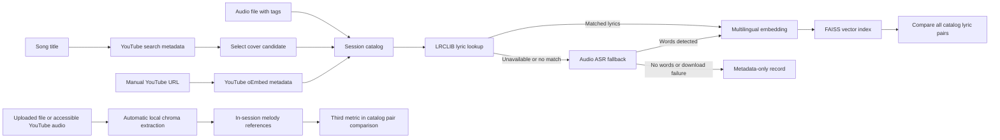

# Semantic Cover Search

A local-first research prototype for discovering song covers on YouTube and comparing songs through lyric and experimental audio similarity. **Melody comparison uses features automatically extracted from uploaded audio files and accessible YouTube recordings**; it cannot identify arbitrary unindexed songs across the internet.

## Features

- **Discover covers on YouTube:** search YouTube for a song title plus "cover" using `yt-dlp`. Results show video title, channel and watch link. Search metadata is not confirmation that a video is a cover or that the uploader is the performing artist.
- **Local catalog:** add a result from YouTube search, paste a YouTube URL, or upload an audio file. Uploaded MP3 tags can prefill an editable song title and performing artist. YouTube URLs are resolved to public title/uploader metadata via oEmbed.
- **Lyrics-first, ASR fallback:** retrieve title-matched reference lyrics through the LRCLIB no-key API. If none are available **or the provider fails**, transcribe the uploaded audio or a bounded download of the selected YouTube video with **NVIDIA Parakeet TDT (CPU)** as the only transcription engine. Index recognized text with local embeddings in FAISS. If both routes fail, retain a metadata-only entry rather than indexing invented words. LRCLIB lyrics may represent a different rendition, and speech recognition of singing may be inaccurate.
- **Metadata-only entries and retries:** if neither reference lyrics nor fallback transcription produces usable text (or embedding fails), retain metadata without inventing a searchable vector. Re-adding the same metadata-only song retries LRCLIB/YouTube and updates its existing entry if the services recover, without duplicating the catalog row. Status and columns distinguish reference lyrics, automatic transcription and metadata only.
- **Compare catalog songs:** click **Compare all catalog lyrics** to evaluate each pair with measurable features. The cards display three separate metrics: shared lyric phrases (three-word Jaccard), semantic similarity (embedding cosine × 100), and optional **tonal pattern similarity (experimental chroma alignment)**. The third measure is available when both recordings have usable audio features, whether uploaded locally or retrieved from an accessible YouTube video. If audio cannot be accessed, the measure correctly shows N/A. Audio-only pairs can still be compared even without recognized lyrics. No API calls or audio downloads are needed at comparison time.
- **Automatic melody analysis for uploads and YouTube:** when a song is added, the app attempts to extract normalized 12-bin chroma audio features (up to three minutes). Uploaded files are read locally; YouTube URLs trigger a single bounded download when available, even if LRCLIB already provided the lyrics. The *same* media bytes are reused for ASR only if lyrics are missing. If the download or audio analysis fails, the lyric entry remains available and the melody column shows **Not analyzed**. Up to 12 reference feature matrices remain in session memory; raw media is not retained in the catalog. The tonal pattern metric is experimental and not a song-identification probability or an isolated vocal-melody measurement.
- **Shared catalog job queue:** file uploads, manually pasted YouTube links, confirmed search-result videos and catalog-wide comparisons share a **single Gradio concurrency group (limit 1)**. Starting a different import while one is processing queues the new job instead of overlapping or cancelling the first. Metadata-only YouTube discovery remains independent and can run in parallel. The catalog refreshes after each queued import; restarting Gradio discards queued jobs and the in-memory catalog.
- **Session-only state:** no database and no persistence. Restarting Gradio clears the catalog; this is intentional for a small demo.

## Architecture



**Important:** Neither YouTube metadata nor LRCLIB verifies a cover relationship. Parakeet is intended for speech recognition and may fail on singing. Chroma matching is a lightweight **experimental** music-feature comparison: polyphonic backing instruments, room noise and different arrangements can obscure the principal sung melody. It is not DTW, a learned music-identification model, or internet-wide recognition. Results must be confirmed by listening.

## Installation

Use Python 3.11 or 3.12 and a per-project virtual environment.

```powershell
py -3.12 -m venv .venv
.\.venv\Scripts\python.exe -m pip install -r requirements.txt
.\.venv\Scripts\python.exe app.py
```

The app runs at `http://127.0.0.1:7860` by default. The Gradio interface uses a responsive light theme, compact YouTube cards with thumbnails, and paired lyric-comparison cards. The first song-import request requiring automatic speech recognition can download the Parakeet model (approximately 670 MB) if it is not cached. If the recording is added from YouTube, the app attempts **one bounded download** to extract melodic features, regardless of LRCLIB results. It runs whole-song ASR **only when reference lyrics are unavailable**, reusing the downloaded bytes. A YouTube video may be unavailable because of platform restrictions or missing formats; then the lyrics may still be indexed and melody comparison will show **N/A**. Downloading and CPU processing can take longer than metadata-only discovery.

## Audio uploads without extracted lyrics

An audio file with **Melody: Ready** was successfully decoded for tonal analysis. This does not guarantee successful lyric transcription: **NVIDIA Parakeet recognizes speech, not isolated singing**, and may return no words for fully produced music. The fallback also depends on LRCLIB connectivity and whether the title/artist exist there. A temporary HTTP 503 from LRCLIB is a service failure, not a definitive missing-lyrics result.

This portfolio demo deliberately **does not offer microphone song recognition**, because short sung clips did not reliably yield the words required for a YouTube text search. Keep discovery by song title and the local catalog as the supported flows. Potential improvements in music transcription are future research, not promised capabilities.

## Transcription model

**NVIDIA Parakeet TDT 0.6B v3 is the only transcription backend.** It runs locally through sherpa-onnx without an API key. There is no alternate speech-recognition backend or runtime engine switch. Singing, humming and accompaniment can still make speech recognition inaccurate; LRCLIB lyrics remain the first choice.

The Hugging Face progress lines `Download complete` / `Reconstruction complete: 0.00B` relate to downloading or retrieving model assets from cache; they are informational and not evidence of a failed transcription by themselves.

## External-service troubleshooting

If a YouTube song is added as **Metadata only** with an LRCLIB connection error and a `DownloadError`, **both independent providers failed**. That does not mean the song lacks lyrics. Check the terminal for the underlying LRCLIB / yt-dlp exception and network/proxy/TLS information. LRCLIB connection failures are retried once, but an outage or network block may persist.

If YouTube warns about the missing JavaScript runtime, this is a **yt-dlp/YouTube extraction warning**, not a Parakeet problem. The Python extra `yt-dlp[default]` installs EJS helper scripts, but does **not** install a JavaScript runtime. Follow the [official yt-dlp EJS guide](https://github.com/yt-dlp/yt-dlp/wiki/EJS). On Windows, Deno can be installed with `winget install -e --id DenoLand.Deno` (system-level dependency, not a Python virtual environment package), then restart the terminal and check `deno --version`. Install the updated Python dependencies inside the project's existing `.venv` using `.\\.venv\\Scripts\\python.exe -m pip install -U -e .`; the `yt-dlp[default]` extra supplies matching EJS scripts. A supported runtime can improve extraction but cannot override video restrictions or guarantee every download.

You can retry a failed **metadata-only** catalog entry by selecting the same video or adding its URL again, without restarting Gradio. If LRCLIB recovers but YouTube does not, lyrics can still be indexed; melody remains *Not analyzed*. Audio extraction is bounded by duration/file-size controls. To isolate external availability from catalog code, upload a locally accessible song audio file.

## Interpreting tonal-pattern scores

The previous implementation compared normalized 12-bin chroma vectors from the **whole mixed audio**. Because most notes contain broad harmonic energy, unrelated recordings could produce almost identical chroma vectors. Searching over time offsets, transpositions and tempo variants could then return misleading ~99% alignment scores.

The experimental matcher now subtracts each recording's stable pitch-class background and compares **changing tonal patterns** instead. If the audio contains no discriminative tonal changes, the metric is **N/A** rather than an artificial high match. It does not isolate the singer or identify a tune from its true melodic contour. A high score means the tonal patterns aligned under the tested transformations, **not** that the songs are confirmed covers. Real-world validation requires an annotated benchmark of same-song/different-song recordings and ranking metrics such as Recall@K. Lyrics matching remains independent.

## Testing the job queue

1. Start importing a YouTube result that requires lyric lookup, embedding, or audio analysis.
2. Before it finishes, switch to **Local catalog**, upload a different audio file, and click **Add song to catalog**.
3. The second import must **wait**, while the first finishes and updates the session catalog. Both entries should appear afterward; one job must not cancel the other.
4. Repeat with **Add link to catalog** and **Compare all catalog lyrics**. Comparison must run only after queued imports finish. **Discover covers on YouTube** can still search video metadata independently.

The queue is intentionally serial for CPU reliability and to avoid concurrent writes to the session catalog. Queued work is not persistent across browser/server restarts; do not close/restart the running app while testing.

## Testing the melody prototype

1. In **Local catalog**, add two uploaded audio files or accessible YouTube recordings. Melody features are extracted automatically during addition, even when LRCLIB supplies lyrics.
2. Verify that the catalog marks **Melody** as *Ready* for accessible analyzed audio. A YouTube URL may display *Not analyzed* if the audio cannot be obtained, is too long/large, or melody extraction fails. Reference lyrics can still be available in those cases.
3. Click **Compare all catalog lyrics**. The same comparison cards now show **Shared lyric phrases**, **Semantic similarity** and **Tonal pattern similarity · experimental**. The last metric should show N/A for pairs missing audio features.
4. Add an MP3 with sung vocals. If Parakeet cannot recognize the lyrics, the song stays **Metadata only** but may still have **Melody: Ready**. This means audio processing worked, not that a transcription succeeded.
5. To compare songs, use **Compare all catalog lyrics** in Local catalog. Session data resets when Gradio restarts.

This is an experimental **temporal chroma-change** baseline, not isolated melody extraction or robust song identification. Previously, raw cosine of broad-spectrum chroma could exceed 99% even for unrelated songs; stable tonal background is now removed before sequence alignment. The corrected number is still uncalibrated, and similar chord progressions or backing instruments can mislead it. The app does not search unindexed songs on YouTube by audio. A future version could use predominant-melody extraction and a rights-cleared reference corpus.

## Testing

```powershell
.\.venv\Scripts\python.exe -m pytest -q
.\.venv\Scripts\python.exe -m ruff check .
```

Tests mock outside services and do not prove real YouTube or LRCLIB availability, nor melodic/lyric matching accuracy.

## Privacy, provider limitations and rights

- YouTube search uses third-party extraction and downloads only when the source is accessible. See **External-service troubleshooting** above for yt-dlp, matching EJS scripts and Deno setup.
- [LRCLIB](https://lrclib.net/docs) provides a no-key API, with published rate limits and identification requirements. This demo fetches lyrics on demand rather than redistributing a local database. Song lyrics may be copyrighted independently of the API/software license: **check lyric display/indexing rights before public deployment**, even when data comes from an API. Each lyric panel links to the source. Other no-key services such as lyrics.ovh scrape third-party lyric pages and are not enabled as a fallback because their data provenance/reuse terms do not provide a clear basis for a public showcase.
- Uploaded file metadata and spectral melody features are processed locally. Uploaded audio is transcribed locally by Parakeet when no reference lyrics were found, and may separately be analyzed for tonal patterns; known song titles can be sent to LRCLIB; video titles and URLs can be sent to YouTube services.
- The catalog stays in Gradio's session memory. Uploaded files and bounded YouTube downloads are processed for melody automatically where available, retaining only pitch-class features rather than raw audio in the app catalog. The yt-dlp download uses temporary files, and Gradio may also manage temporary uploads during the session. Confirm the platform's terms and your rights to access media before deploying this feature publicly.
- An old `.local_data/catalog.sqlite3` created by previous development versions is no longer used. `.local_data/` stays in `.gitignore` to prevent accidental commits.

## Potential Enhancements

- Better melodic matching using predominant vocal-pitch extraction or chroma/DTW models with a curated, rights-cleared reference corpus, plus quantitative Recall@K evaluation.
- Segment-level lyric indexing to improve short-fragment retrieval and distinguish partial shared verses from generic semantic proximity.
- Test sets of original recordings, covers and unrelated songs, with Recall@K and ranking quality metrics.
- Rights-cleared, user-facing lyric references for a public deployment.
