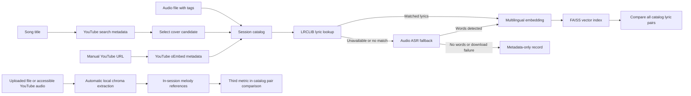

# Semantic Cover Search

**[Live demo on Hugging Face Spaces](https://huggingface.co/spaces/esthermariamh/semantic-cover-search)** · Gradio · ZeroGPU hosting

Semantic Cover Search is a research-oriented application for discovering candidate song covers on YouTube and comparing recordings through **lyric similarity and experimental audio features**. It combines reference-lyric retrieval, local speech recognition, multilingual text embeddings and tonal-pattern analysis in a temporary session catalog. It does **not** identify arbitrary, unindexed songs from audio.

## Features

- **YouTube cover discovery:** search by song title and explore candidate recordings with video titles, channels and links. Search results are not verified cover relationships.
- **Session catalog:** add YouTube search results, paste supported YouTube links or upload audio files. MP3 metadata can prefill editable title and performer fields.
- **Lyrics with ASR fallback:** query LRCLIB for matching reference lyrics; if unavailable, attempt local transcription with **NVIDIA Parakeet TDT 0.6B v3** through sherpa-onnx on CPU. If neither route yields usable text, preserve a metadata-only entry that can be retried.
- **Semantic retrieval:** encode available text with a multilingual sentence embedding model and maintain an in-memory **FAISS** index.
- **Pairwise comparisons:** calculate three-word phrase overlap, embedding cosine similarity, and—when both recordings provide usable audio—experimental chroma-based tonal-pattern similarity. Unavailable measurements display **N/A**, rather than fabricated scores.
- **Audio analysis:** extract bounded chroma features from uploaded or accessible YouTube audio; raw audio is not retained in the session catalog.
- **Queued processing:** serialize catalog imports and comparisons to avoid concurrent state changes. YouTube metadata discovery runs separately.

Catalog data is temporary: it is not saved to a database and is lost when the session/server state is cleared.

## Architecture



The text and audio pipelines are independent: an entry can have lyrics without audio features, audio features without recognized lyrics, or metadata only. Comparison scores are exploratory measurements, **not probabilities that two recordings are covers of the same song**.

## Live demo and deployment

**[Open Semantic Cover Search](https://huggingface.co/spaces/esthermariamh/semantic-cover-search)**

The public Gradio Space is synchronized from this repository through GitHub Actions. It runs on Hugging Face ZeroGPU, but the main catalog pipeline—Parakeet ASR, local embeddings, FAISS and chroma extraction—currently runs on **CPU**. The registered GPU callback is a hosting compatibility mechanism; it does not accelerate those catalog operations.

External-service availability, model downloads and resource limits can affect individual operations. The earlier full local version is retained in the [`local-full` branch](https://github.com/EMH01/semantic-cover-search/tree/local-full).

## Local installation

Use **Python 3.11 or 3.12**.

**Windows (PowerShell)**

```powershell
py -3.12 -m venv .venv
.\.venv\Scripts\python.exe -m pip install -e .
.\.venv\Scripts\python.exe app.py
```

**Linux / macOS**

```bash
python3 -m venv .venv
source .venv/bin/activate
python -m pip install -e .
python app.py
```

The interface runs at `http://127.0.0.1:7860` by default. The first transcription request may download approximately 670 MB of Parakeet model files. Audio processing can be slower than metadata-only lookup. The default embedding and speech-recognition paths do not require a paid inference API.

## Testing

Install development dependencies and run the checks:

```bash
python -m pip install -e ".[dev]"
python -m pytest -q
python -m ruff check .
```

The automated tests mock external services; they do not establish real-time YouTube/LRCLIB availability or song-matching accuracy. Detailed manual checks and service troubleshooting are in [Development and troubleshooting notes](docs/development-and-troubleshooting.md).

## Limitations, privacy and rights

- **No verified cover identification:** YouTube metadata and matching reference lyrics do not prove that two recordings are versions of the same work.
- **Transcription:** Parakeet is a speech recognizer, so singing, accompaniment and humming can produce incomplete or empty transcriptions. This is not microphone-based song recognition.
- **Tonal analysis:** normalized chroma captures pitch-class patterns in mixed audio, not an isolated vocal melody. Similar arrangements or accompaniment can produce misleading scores. A labelled benchmark is needed to evaluate retrieval quality.
- **External services:** LRCLIB and YouTube can rate-limit or block retrievals; inaccessible audio leaves tonal analysis unavailable. Reference lyrics may differ from a particular performance.
- **Data handling:** audio is processed for transcription and/or chroma extraction, while song metadata, text vectors and pitch-class features are held in a temporary Gradio catalog. Gradio and download tools may create temporary files; the application does not promise secure deletion of all such files.
- **Rights:** lyrics and recordings can be copyrighted independently of service APIs. Users should ensure they have appropriate rights and follow applicable provider/platform terms when uploading, retrieving or displaying content.

## Potential enhancements

- Evaluate original/cover/unrelated-song rankings on a rights-cleared labelled benchmark, reporting metrics such as Recall@K.
- Improve segment-level lyric retrieval and compare against stronger melody or predominant-pitch approaches.
- Investigate a rights-cleared reference collection for reproducible audio evaluation.
