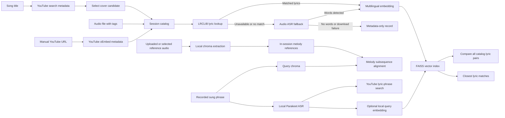

# Semantic Cover Search

A local-first research prototype for discovering song covers on YouTube and comparing songs through lyric and experimental audio similarity. **Melody matching works only against audio references explicitly analyzed in the session catalog**; it cannot identify arbitrary unindexed songs across the internet.

## Features

- **Discover covers on YouTube:** search YouTube for a song title plus "cover" using `yt-dlp`. Results show video title, channel and watch link. Search metadata is not confirmation that a video is a cover or that the uploader is the performing artist.
- **Local catalog:** add a result from YouTube search, paste a YouTube URL, or upload an audio file. Uploaded MP3 tags can prefill an editable song title and performing artist. YouTube URLs are resolved to public title/uploader metadata via oEmbed.
- **Lyrics-first, ASR fallback:** retrieve title-matched reference lyrics through the LRCLIB no-key API. If none are available **or the provider fails**, transcribe the uploaded audio or a bounded download of the selected YouTube video with the configured speech recognizer (Parakeet TDT on CPU by default). Index recognized text with local embeddings in FAISS. If both routes fail, retain a metadata-only entry rather than indexing invented words. LRCLIB lyrics may represent a different rendition, and speech recognition of singing may be inaccurate.
- **Metadata-only entries:** if neither reference lyrics nor the fallback transcription produces usable text (or embedding fails), retain the song in the catalog without a searchable vector. Status and catalog columns distinguish **reference lyrics**, **automatic transcription**, and **metadata only**.
- **Compare all catalog lyrics:** in **Local catalog**, click **Compare all catalog lyrics** to evaluate every unique song pair with indexed text. Rank pairs by shared consecutive three-word phrases (Jaccard overlap), then local embedding cosine similarity, displayed as separate measurements. Uses already-computed vectors; no repeat API calls, transcription or download. Metadata-only songs are excluded, and the view reports their count. Identical reference lyrics are **not proof** that two uploaded or linked performances are covers.
- **Recording search (in Local catalog):** under the YouTube URL field, record a short phrase using the microphone. Use locally recognized words to discover YouTube candidates or compare the transcription with indexed lyrics in the catalog. These search methods remain lyric-based.
- **Experimental melody matching:** explicitly choose **Analyze this audio as a melody reference** for a local upload or **Analyze this YouTube melody (experimental)** for a pasted video URL. Audio is processed transiently; only 12-bin chroma features are stored in session memory, never raw media. A short sung/hummed recording can then be compared to up to 12 catalog references using subsequence chroma correlation, tolerating transposition and modest tempo changes. This does **not** search YouTube by sound, perform acoustic fingerprinting, isolate vocals, or recognize an unindexed song. The alignment score is not a song-identification probability.
- **Session-only state:** no database and no persistence. Restarting Gradio clears the catalog; this is intentional for a small demo.

## Architecture



**Important:** Neither YouTube metadata nor LRCLIB verifies a cover relationship. Parakeet is intended for speech recognition and may fail on singing. Chroma matching is a lightweight **experimental** music-feature comparison: polyphonic backing instruments, room noise and different arrangements can overwhelm a hummed vocal line. It is not DTW, a learned music-identification model, or internet-wide recognition. Results must be confirmed by listening.

## Installation

Use Python 3.11 or 3.12 and a per-project virtual environment.

```powershell
py -3.12 -m venv .venv
.\.venv\Scripts\python.exe -m pip install -r requirements.txt
.\.venv\Scripts\python.exe app.py
```

The app runs at `http://127.0.0.1:7860` by default. The Gradio interface uses a responsive light theme, compact YouTube cards with thumbnails, and paired lyric-comparison cards. The first **singing-search** request can download the Parakeet model (approximately 670 MB) if it is not cached. If LRCLIB provides lyrics, adding a song does **not** download its YouTube audio or run full-song transcription. Otherwise the app attempts one size/duration-limited download and speech transcription. This fallback can take significantly longer on CPU.

## Testing the melody prototype

1. In **Local catalog**, upload an audio recording with a clear musical phrase and click **Analyze this audio as a melody reference**. An entry can be melody-indexed even if it has no lyrics.
2. For a different reference, paste a YouTube video link and explicitly click **Analyze this YouTube melody (experimental)**. The latter downloads bounded audio only when requested, and analyzes its first three minutes at most.
3. Under the YouTube link, expand **Search by singing or humming · experimental**. Record 5–20 seconds of melody with the microphone and click **Find matching melodies**.
4. Examine the ranked candidates, their score (chroma alignment × 100, **not a probability**) and approximate position in the analyzed reference. Compare several real examples: same melody, different melody, and a hummed or transposed phrase.
5. If the catalog contains no melody references, the recording search asks you to index at least one. Catalog melody data resets when the Gradio session ends.

This is **not** a promise of robust commercial-song recognition: singing a cappella and comparing against full instrumental mixes may give poor rankings. A future research iteration could use predominant-melody extraction and aligned, rights-cleared reference corpora.

## Testing

```powershell
.\.venv\Scripts\python.exe -m pytest -q
.\.venv\Scripts\python.exe -m ruff check .
```

Tests mock outside services and do not prove real YouTube or LRCLIB availability, nor melodic/lyric matching accuracy.

## Privacy, provider limitations and rights

- YouTube search uses third-party extraction. Depending on the version, `yt-dlp` may need a JavaScript runtime for complete YouTube support. See the [official setup guide](https://github.com/yt-dlp/yt-dlp/wiki/EJS).
- [LRCLIB](https://lrclib.net/docs) provides a no-key API, with published rate limits and identification requirements. This demo fetches lyrics on demand rather than redistributing a local database. Song lyrics may be copyrighted independently of the API/software license: **check lyric display/indexing rights before public deployment**, even when data comes from an API. Each lyric panel links to the source. Other no-key services such as lyrics.ovh scrape third-party lyric pages and are not enabled as a fallback because their data provenance/reuse terms do not provide a clear basis for a public showcase.
- Uploaded file metadata and spectral melody features are processed locally. The singing recording is processed locally by Parakeet/Whisper or by chroma analysis; known song titles can be sent to LRCLIB; video titles and URLs can be sent to YouTube services.
- The catalog stays in Gradio's server/session memory only. Audio used for fallback and explicit melody analysis is processed transiently and is not stored in a project database.
- An old `.local_data/catalog.sqlite3` created by previous development versions is no longer used. `.local_data/` stays in `.gitignore` to prevent accidental commits.

## Potential Enhancements

- Better melodic matching using predominant vocal-pitch extraction or chroma/DTW models with a curated, rights-cleared reference corpus, plus quantitative Recall@K evaluation.
- Segment-level lyric indexing to improve short-fragment retrieval and distinguish partial shared verses from generic semantic proximity.
- Test sets of original recordings, covers and unrelated songs, with Recall@K and ranking quality metrics.
- Rights-cleared, user-facing lyric references for a public deployment.
