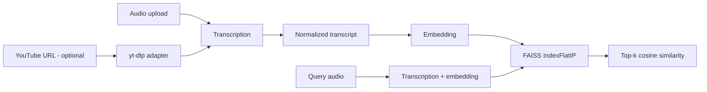

# Semantic Cover Search

A semantic audio-search experiment for finding **songs with similar transcribed lyrics**.

This project evolved from an earlier cover-search experiment. The core idea is preserved—transcribe songs, embed the lyrics, and search by semantic similarity—but the implementation is now split into testable components while keeping YouTube extraction isolated in its own adapter.

## Pipeline



## What changed from the original experiment

- **Stable primary input:** uploaded audio works independently of YouTube.
- **YouTube adapter:** `yt-dlp` is installed with the application but isolated in its own module because third-party extraction behavior changes over time.
- **Reusable model instances:** local Faster-Whisper and multilingual embedding models load lazily once per process.
- **Correct embedding input:** segmented transcription output is normalized into one text string before embedding.
- **Explicit vector index:** normalized embeddings use FAISS inner-product search as cosine similarity.
- **Testable core:** ranking, duplicate detection, transcription normalization, and embedding normalization are covered without real API calls.

## Stack

- Python 3.11+
- NVIDIA Parakeet TDT 0.6B v3 via sherpa-onnx (default CPU speech recognition)
- Faster-Whisper (comparison backend; CPU, `base`, int8)
- Sentence Transformers (`paraphrase-multilingual-MiniLM-L12-v2`, CPU)
- Optional OpenAI transcription and embeddings (requires a key)
- FAISS
- Gradio
- `yt-dlp` (YouTube and YouTube Music adapter)

## Project structure

```text
.
├── app.py
├── src/cover_search/
│   ├── config.py
│   ├── index.py
│   ├── local.py
│   ├── parakeet.py
│   ├── models.py
│   ├── services.py
│   └── youtube.py
├── tests/
│   ├── test_index.py
│   ├── test_services.py
│   ├── test_local.py
│   ├── test_parakeet.py
│   └── test_reliability.py
├── .env.example
├── requirements.txt
└── pyproject.toml
```

## Setup

```bash
python -m venv .venv
source .venv/bin/activate        # macOS/Linux
# .venv\Scripts\activate       # Windows

pip install -r requirements.txt
cp .env.example .env  # Windows: copy .env.example .env
```

The default `AI_PROVIDER=local` needs **no API key**. Model weights are downloaded on first use; the host needs an internet connection for that initial download. Then run:

```bash
python app.py
```

## Configuration

| Variable | Purpose | Default |
|---|---|---|
| `AI_PROVIDER` | Local inference by default; OpenAI is optional | `local` |
| `ASR_ENGINE` | Local speech recognizer: `parakeet` or `whisper` | `parakeet` |
| `LOCAL_WHISPER_MODEL` | Faster-Whisper model size | `base` |
| `LOCAL_EMBEDDING_MODEL` | Multilingual sentence-transformer model | `sentence-transformers/paraphrase-multilingual-MiniLM-L12-v2` |
| `OPENAI_API_KEY` | Needed only for the optional OpenAI provider | not required |
| `OPENAI_TRANSCRIPTION_MODEL` | Optional OpenAI speech-to-text model | `gpt-transcribe` |
| `OPENAI_EMBEDDING_MODEL` | Optional OpenAI embedding model | `text-embedding-3-small` |

## Quality checks

```bash
ruff check .
pytest -q
```

## Retrieval notes

FAISS `IndexFlatIP` returns inner-product scores. Because every stored/query vector is L2-normalized, the score is equivalent to cosine similarity. The UI reports this value as a percentage-like similarity score for exploration; it should **not** be interpreted as a calibrated probability that two recordings are covers of the same song.

## Current scope and validation roadmap

The current implementation establishes a reproducible architecture. The next step is empirical validation:

- create a small labelled set containing originals, known covers, and unrelated songs
- measure Recall@K / ranking quality
- compare transcription providers and embedding models
- test multilingual covers and translated lyrics
- evaluate robustness to instrumental sections and noisy recordings
- add screenshots / demo media after the UI is validated

## Project evolution

This implementation supersedes the earlier prototype and is the maintained version of the project.

## Local inference limitations

Parakeet and Faster-Whisper recognize speech and lyrics acoustically, but results can be unreliable on dense music, instrumentals, and noisy recordings. Embeddings compare **transcribed language**, not musical structure; the similarity score is not a probability of two recordings being covers. First use loads two local models into RAM and CPU transcription may take time. The Gradio catalog is scoped to each browser session and is not persistent.

## Default Parakeet speech recognition

The default backend is NVIDIA **Parakeet TDT 0.6B v3**, served locally with **sherpa-onnx** using the converted INT8 ONNX model from [csukuangfj](https://huggingface.co/csukuangfj/sherpa-onnx-nemo-parakeet-tdt-0.6b-v3-int8). Its approximate 670 MB model files are downloaded to the Hugging Face cache on first transcription; no API token or inference subscription is required. Audio is decoded to mono 16 kHz using PyAV.

To compare with Faster-Whisper, configure `ASR_ENGINE=whisper` in your `.env` file and restart the app. The ASR engine does **not** compare melodies; songs are still retrieved by the meaning of the recognized lyrics. Windows inference and recognition of singing require real-device validation. Some sherpa-onnx Windows versions have been reported to return empty transcriptions with this architecture. The app raises an explicit error instead of inventing a result.
